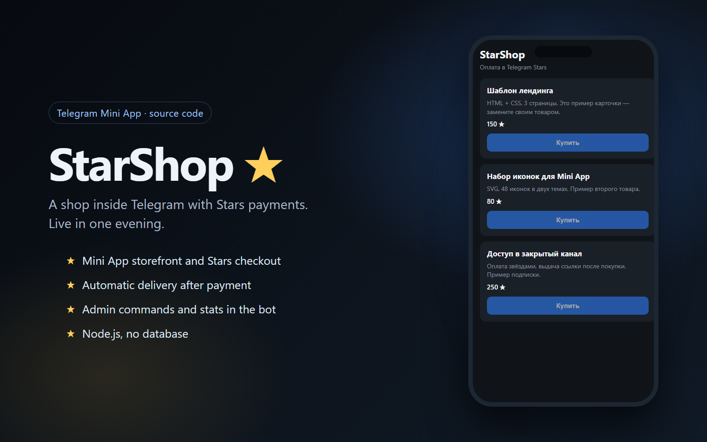

# StarShop — Telegram Mini App store demo

Interactive demo of **StarShop**, a ready-to-launch Telegram Mini App storefront with Telegram Stars payments, automatic delivery and an admin bot inside Telegram.

**Live demo:** https://gev25.github.io/starshop-demo/



## What the demo shows

- Telegram-style storefront that follows the user's light or dark theme
- Product catalog rendered from mock data (no backend calls)
- Stars checkout flow: invoice sheet with product and price
- Responsive phone mockup layout

The demo runs on mock data: no Telegram account is required and no Stars are charged.

## Get the full source code

This repository is only the demo page. The product — a Node.js Mini App store with a grammY bot, HMAC-verified `initData`, orders in JSON, automatic file delivery and admin commands — is sold separately:

- **StarShop alone:** [Gumroad — $22](https://abrahamyangev.gumroad.com/l/starshop-telegram-mini-app) · [Plati (RU) — 1 927 ₽](https://plati.market/itm/starshop-a-telegram-mini-app-store-with-payment-in-stars/6414317)
- **Telegram Sales Starter Pack** (StarShop + Python auto-sales bot + FastAPI data toolkit): [Gumroad — $24](https://abrahamyangev.gumroad.com/l/telegram-sales-starter-pack) · [Plati (RU) — 2 054 ₽](https://plati.market/itm/telegram-sales-starter-pack-3-store-source-codes-for-telegram/6418396)

## Run locally

No build step and no dependencies — plain HTML, CSS and JavaScript.

```bash
# any static server works
python -m http.server 8080
# then open http://localhost:8080
```

## Structure

| File | Purpose |
| --- | --- |
| `index.html` | Landing page: hero, phone demo, features, pricing links |
| `styles.css` | Layout and Telegram-like storefront styling |
| `app.js` | Mock catalog data, invoice sheet interactions |
| `assets/` | Cover and thumbnail images |

## License

The demo page is published for evaluation purposes. The commercial source code is distributed under the license included in the purchased archive.
